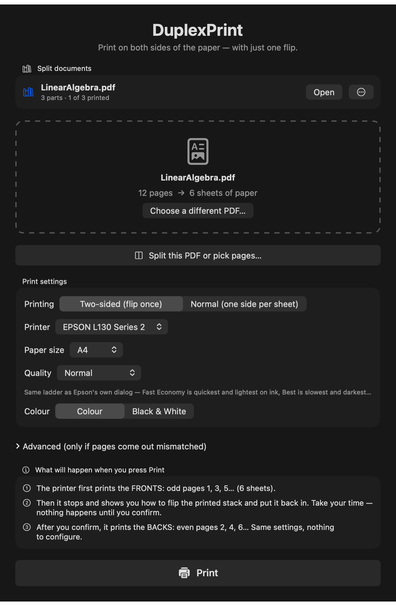
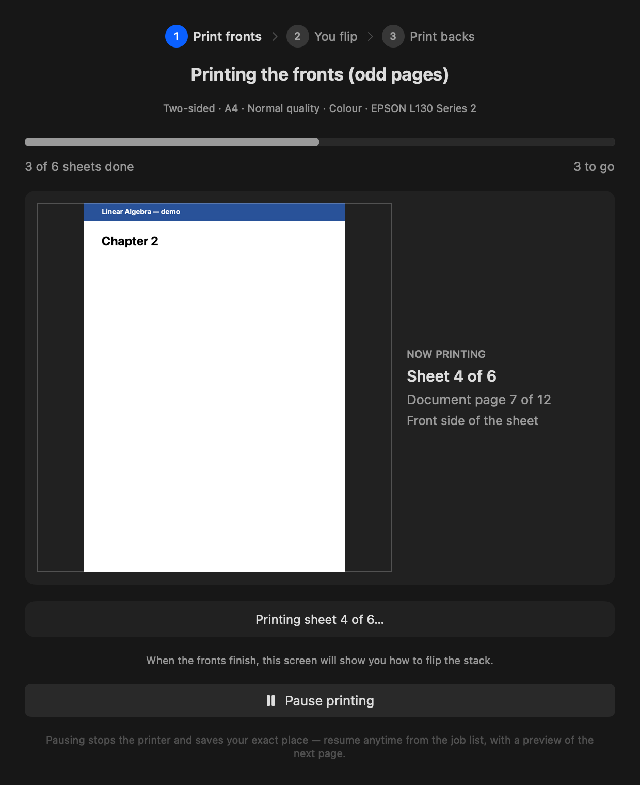
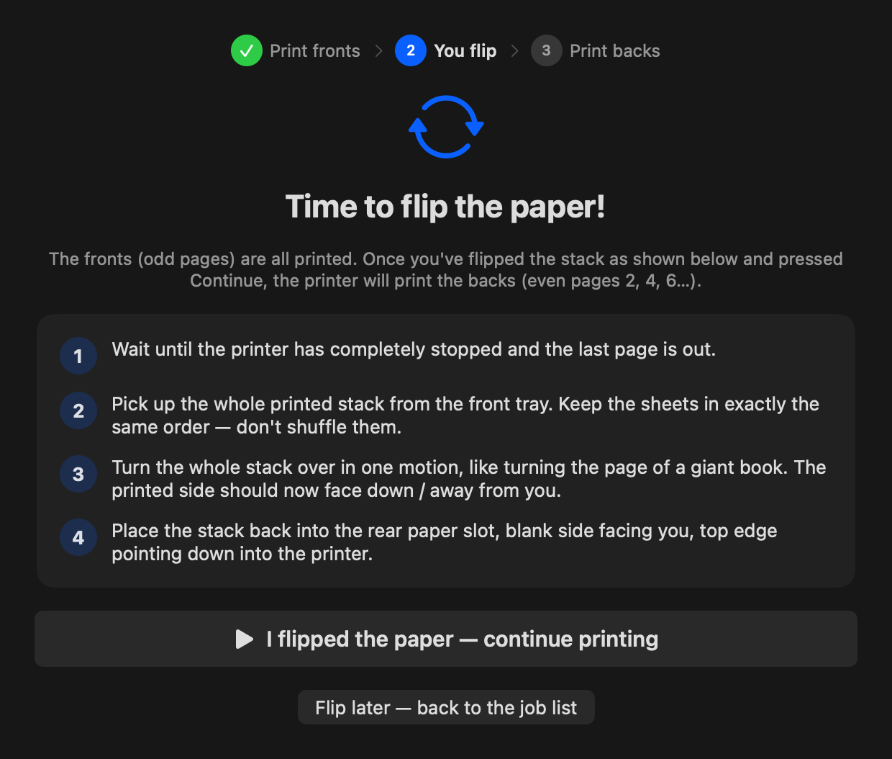
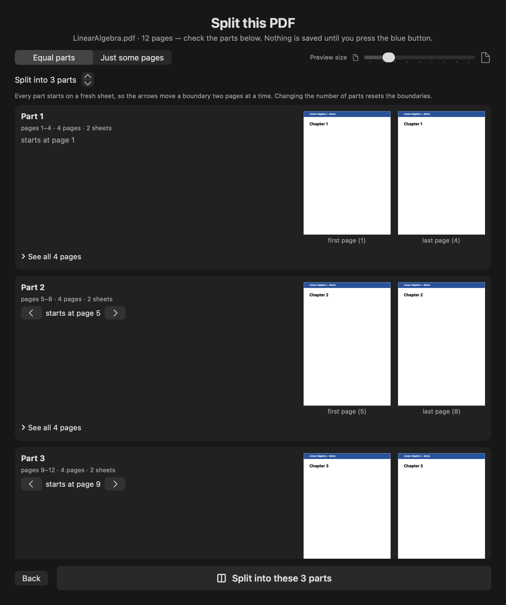
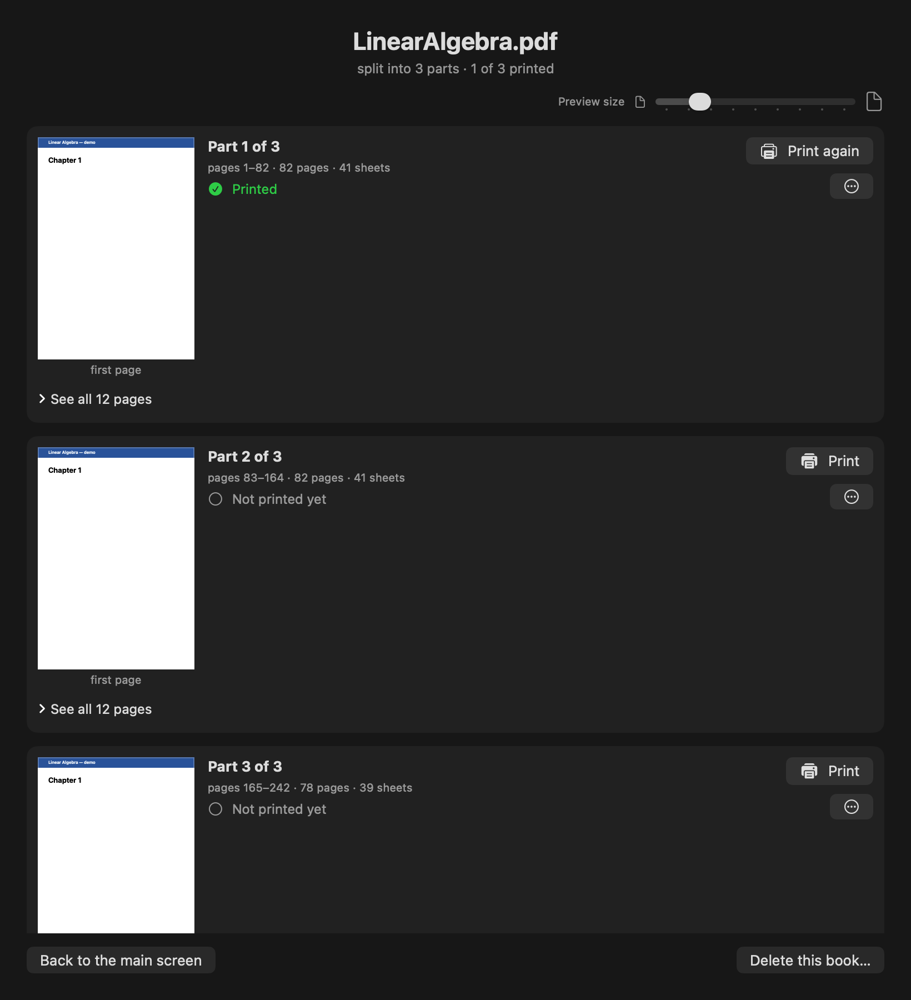
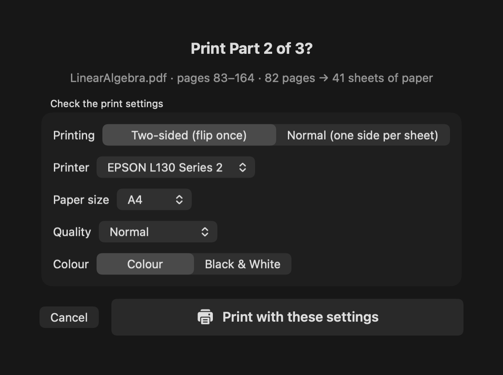

# DuplexPrint

A native macOS app that gives single-sided printers (built for the Epson L130) a
friendly, crash-proof printing workflow — **manual two-sided printing** with one
guided flip, **plain single-sided printing**, and a **PDF splitter** that turns a
big book into printable parts the app tracks for you. Designed so someone with
zero technical knowledge can print a whole book double-sided.

   

<p align="center">
  
</p>

## Highlights

- **Two print modes** — *Two-sided (flip once)*: odd pages → guided flip → even
  pages. *Normal*: the whole document in one pass, no flipping. Every setting is
  frozen per job, and the printing screen always shows exactly what it's using.
- **Split a PDF into parts** — cut a 242-page book into equal parts (each part
  always starts on a fresh sheet) or pull out just the pages you type
  (`5-20, 35, 40-42`). Check every boundary visually before anything is saved.
- **A book library that remembers** — each split document becomes a "book" with
  per-part status (*Not printed / In progress / Printed ✅*). Print a part, take
  a break, come back next week — the app knows where you left off.
- **Crash-proof job library** — progress is saved after *every sheet*. Quit the
  app, reboot the Mac, or lose power, and it offers to resume exactly where it
  stopped, showing a preview of the next page so you can match it against your
  physical stack.
- **Self-healing** — out of paper, jams, and open covers get plain-English
  instructions and infinite patience; USB drops and driver wedges get the dead
  job cancelled and resubmitted automatically from the last completed sheet.
- **Keeps the Mac awake** while printing (sleep cuts USB power mid-job), and
  pins the Epson driver's traps (`OutputOrder`, Skip Blank Page) on every job.
- **Zero dependencies** — a single Swift file talking to CUPS via
  `lp`/`lpstat`/`ipptool`.

## The guided flip

The heart of the app: fronts print first, then it walks you through turning the
stack over — nothing happens until you confirm — then the backs print.

<p align="center">
  
  
</p>

## Splitting a PDF

Load a PDF and press **Split this PDF or pick pages…** — a full-screen workshop
shows every proposed part with first/last-page thumbnails, an expandable grid of
every page inside, and arrows to nudge each boundary (in two-sided mode they
move two pages at a time so every part starts on a fresh sheet). The other tab
makes a new PDF from exactly the pages you type, in the order you type them.
Click any thumbnail to read the page full-size (← → to browse).

<p align="center">
  
</p>

Confirming lands on the book's own page, where each part is printed, resumed,
re-printed, or exported ("Save a copy…") independently:

<p align="center">
  
</p>

Nothing prints blindly — every Print goes through a confirmation that shows the
part, the sheet count, and every setting:

<p align="center">
  
</p>

## Install

**From a release DMG** (works on any Mac, Apple Silicon or Intel, macOS 13+):

1. Download `DuplexPrint-<version>.dmg` from [Releases](../../releases).
2. Open it and drag **DuplexPrint.app** onto the **Applications** shortcut.
3. First launch only — the app isn't notarized by Apple, so approve it once:
   - **macOS 15+**: open the app (it gets blocked) → System Settings →
     Privacy & Security → scroll down → **Open Anyway**.
   - **macOS 13/14**: right-click the app → **Open** → **Open**.

**From source** (Xcode command line tools, Swift 5.7+):

```sh
./build.sh                        # build + install to ~/Applications
VERSION=4.2 ./scripts/make-dmg.sh # build a distributable universal DMG into dist/
```

## CI/CD

`.github/workflows/build-dmg.yml` builds the DMG on GitHub's macOS runners:

- **Manually**: Actions → *Build DMG* → *Run workflow* (optionally type a
  version) → download the DMG from the run's artifacts.
- **Release**: `git tag v4.3 && git push origin v4.3` → builds, runs the test
  suite, and publishes a GitHub Release with the DMG attached.

Every build first runs the app's built-in regression harness
(`DuplexPrint --selftest`): split math, page-range parsing, CUPS option
generation, old-job back-compat decoding, and a real on-disk PDF split.
The README screenshots are rendered by the app itself
(`DuplexPrint --screenshots docs/screenshots`) — regenerate them after UI
changes.

## Docs

- [`PLOT.md`](PLOT.md) — project story, architecture, version history, roadmap.
- [`TROUBLESHOOTING.md`](TROUBLESHOOTING.md) — every failure we hit printing
  real books (USB drops, driver wedges, CUPS lying about completion,
  reverse-order PPD defaults, negative page totals, a SwiftUI range-trap
  crash…) with root causes and fixes.

## Printer notes (Epson L130)

The L130 has no duplexer at all. Its driver has two traps this app neutralizes:
`*DefaultOutputOrder: Reverse` (pages come out back-to-front unless explicitly
overridden) and "Skip Blank Page" (silently shifts front/back pairing). The
quality picker exposes the driver's full 8-level ladder (Fast Economy → Best),
named exactly as Epson's own dialog names them. See `TROUBLESHOOTING.md` §12
for the full cheat-sheet.

---

Built with [Claude Code](https://claude.com/claude-code).
